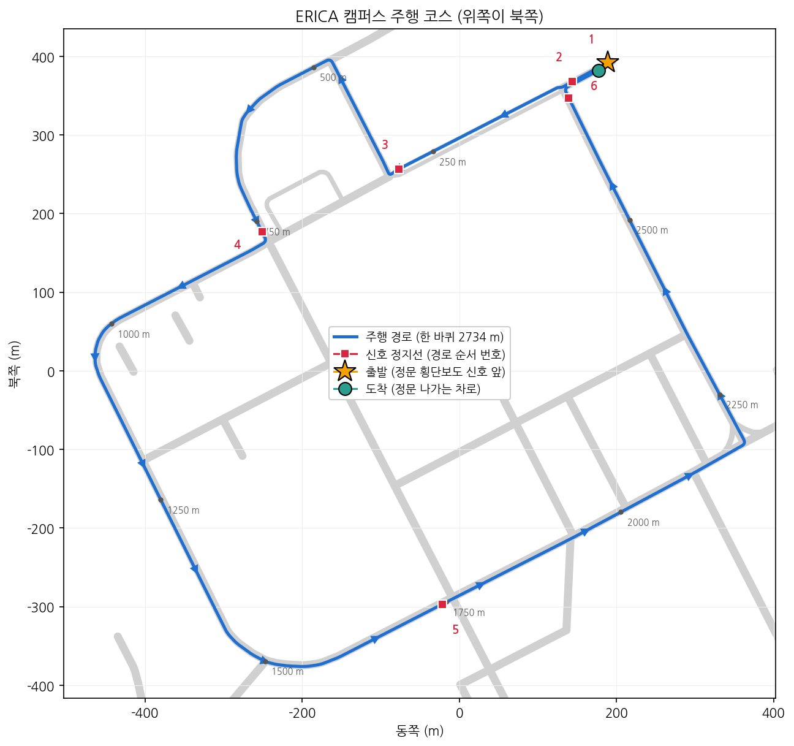
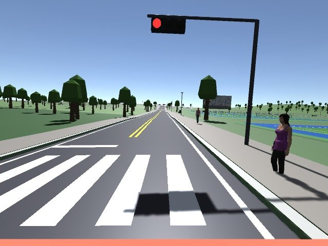
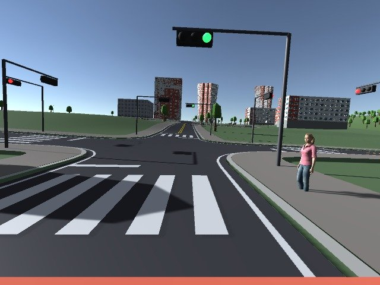
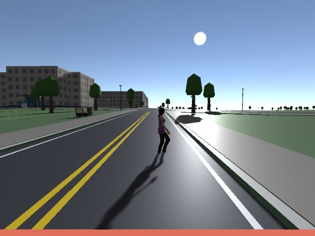
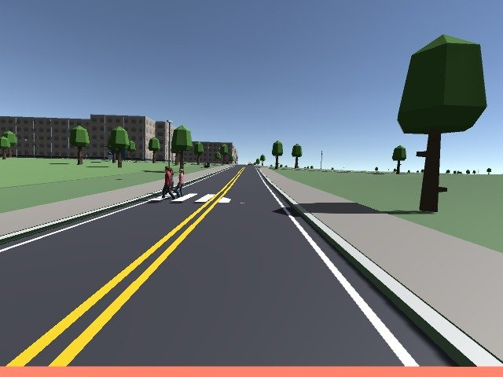
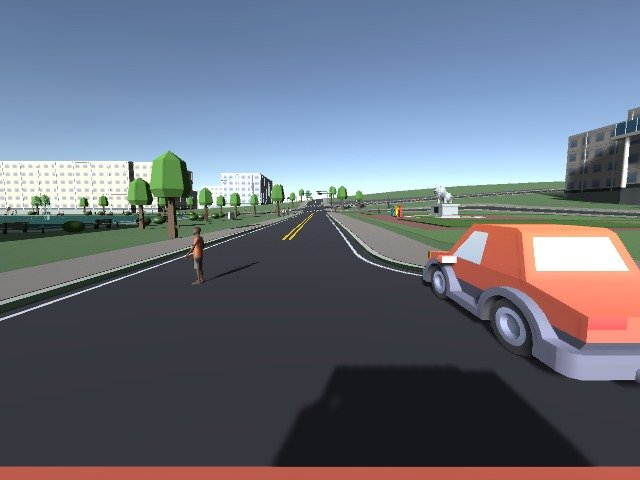
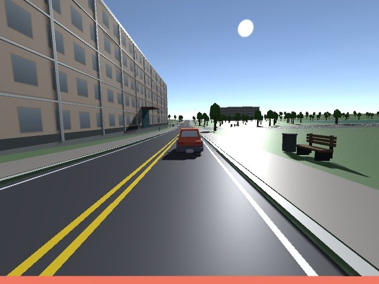
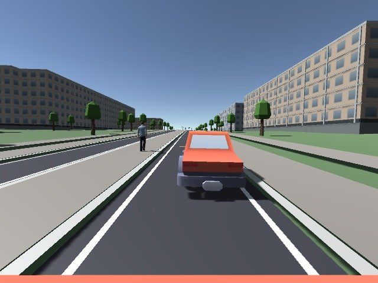
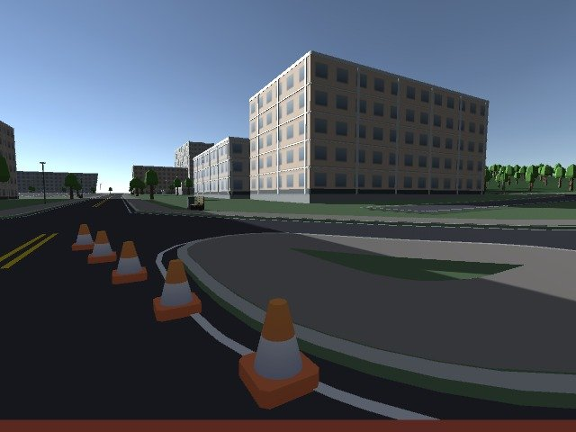
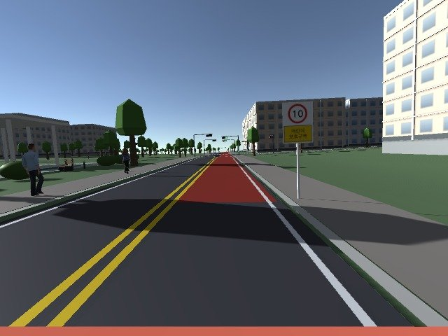

# ERICA 캠퍼스 자율주행 시뮬레이터

시뮬레이터 속 한양대 ERICA 캠퍼스를 한 바퀴(2891 m) 자율주행합니다. 카메라 영상을 OpenCV(필요하면 CNN)로
처리하고, ROS2로 차량을 움직입니다. 주행 중에는 신호등, 무단횡단자, 끼어드는 차량, 공사 콘, 어린이보호구역 같은
**미션 8개가 매번 무작위로** 나타납니다. 위치를 외우거나 하드코딩해서는 통과할 수 없고, 보고 판단해야 합니다.

이 저장소에는 **시뮬레이터와 ROS 브릿지만** 들어 있습니다. 주행 패키지(인식, 판단, 제어 노드와 launch 파일)는
처음부터 직접 만듭니다.

## 1. 준비

### 필요한 환경

| 항목 | 요구 사항 |
|---|---|
| OS | Ubuntu 22.04 (WSL, macOS, Windows는 지원하지 않습니다) |
| ROS | ROS2 Humble (`/opt/ros/humble`) |
| GPU | NVIDIA GPU와 드라이버. 카메라 영상을 GPU로 렌더링합니다 |
| Python | 시스템 Python 3.10. **conda를 켠 터미널에서는 ROS 명령이 깨지므로 끄고 쓰세요** (`conda deactivate`) |

### 설치

```bash
git clone https://github.com/ingyu0808/avsim-assignment.git avsim-assignment
cd avsim-assignment
./scripts/get-sim.sh                          # 시뮬레이터를 받아 UnitySim/Build/Linux에 풉니다
./ros2_ws/setup_deps.sh                       # apt 의존성 설치 (sudo 필요, 처음 한 번)
source /opt/ros/humble/setup.bash
cd ros2_ws && colcon build --symlink-install && cd ..
```

- **시뮬레이터:** 크기 때문에 저장소에 들어 있지 않습니다. `get-sim.sh`가 저장소의 GitHub Release에서 받습니다. 받지 못하면 Releases 페이지에서 `avsim-sim-<버전>.tar.gz`를 브라우저로 받아 `./scripts/get-sim.sh <받은 파일>`로 푸세요.
- **주행 패키지:** `ros2_ws/src` 아래에 직접 만듭니다(예: `cd ros2_ws/src && ros2 pkg create --build-type ament_python my_driver`). 저장소에 없는 폴더라 `git pull`과 겹치지 않습니다.
- **수정본:** 공지가 오면 `git pull` 뒤 `./scripts/get-sim.sh`와 `colcon build`를 다시 실행합니다. 지금 버전은 `VERSION` 파일에 있습니다.
- **압축 묶음으로 받았다면:** `git clone` 대신 `tar xzf avsim-assignment-<버전>.tar.gz`로 풀고 그 폴더에서 시작합니다. 시뮬레이터가 이미 들어 있습니다.

## 2. 실행

터미널 두 개를 씁니다. 두 터미널 모두 먼저 `source /opt/ros/humble/setup.bash && source ros2_ws/install/setup.bash`를 실행합니다.

```bash
# 터미널 1: 시뮬레이터 (ROS 브릿지는 자동으로 뜹니다)
./scripts/run-sim.sh

# 터미널 2: 여러분의 주행 노드
ros2 launch my_driver drive.launch.py
```

처음 설치했다면 시뮬레이터 창이 뜬 뒤 `ros2 topic list`에 아래 3절의 토픽이 보이는지,
`ros2 topic hz /camera/image_raw`가 20 Hz 안팎인지 확인하세요. 시뮬레이터 창에서 `F1`을 누르면 차를 따라가는 카메라로 바뀝니다.

### 시뮬레이터 옵션

| 명령 | 뜻 |
|---|---|
| `./scripts/run-sim.sh` | 매번 새 무작위 판 |
| `./scripts/run-sim.sh --seed 48213` | 같은 판을 다시 (실패한 판 디버깅용) |
| `./scripts/run-sim.sh --no-scenario` | 미션 없는 판 (신호등만 있음) |
| `./scripts/run-sim.sh --result /tmp/run.json` | 판이 끝나면 결과 파일을 이 경로에 씀 |
| `./scripts/run-sim.sh --headless` | 창 없이 실행 (모니터가 없을 때, GPU는 필요) |

- **리셋:** `ros2 service call /reset_simulation std_srvs/srv/Trigger`로 차를 출발 지점으로 되돌립니다. 판이 새 시드로 다시 만들어지고(`--seed`로 실행했다면 같은 판), `/odom`도 원점으로 돌아갑니다.
- **시드 확인:** 판이 만들어질 때마다 시드가 플레이어 로그에 찍힙니다. 리셋할 때마다 새로 찍히므로 **마지막 줄**이 지금 판입니다. 결과 파일에도 시드가 들어 있습니다.
  ```bash
  grep "\[Scenario\] seed" ~/.config/unity3d/DefaultCompany/UnitySim/Player.log | tail -1
  ```

### 문제가 생기면

| 증상 | 해결 |
|---|---|
| 창은 떴는데 `ros2 topic list`에 `/camera/image_raw`가 없다 | 브릿지가 굳은 상태입니다. `systemctl --user restart avsim-ros-bridge` 후 다시 확인 |
| `ros2 topic echo`가 `!rclpy.ok()` 오류를 낸다 | ROS 데몬 문제입니다. `ros2 daemon stop && ros2 daemon start` |
| 차가 움직이지 않는다 | `/cmd_ackermann`이 0.5 s 넘게 끊기면 차가 멈춥니다. `ros2 topic hz /cmd_ackermann`으로 확인하세요 |
| 다른 PC의 토픽이 섞여 값이 튄다 | 같은 네트워크의 다른 시뮬레이터입니다. `export ROS_DOMAIN_ID=<다른 숫자>`를 두 터미널에서 같게 설정하세요 |
| 창이 검게 멈춘다 (모니터 없는 PC) | `--headless`로 실행하세요 |
| 카메라 영상에서 사람·차가 뚝뚝 끊겨 보인다 (10~16 Hz) | 이미지를 best effort(`qos_profile_sensor_data`)로 구독하고 있습니다. 아래 3절처럼 RELIABLE, depth 1로 구독하세요 |

## 3. ROS 인터페이스

### 입력

| 토픽 | 타입 | 주기 | 설명 |
|---|---|---|---|
| `/camera/image_raw` | `sensor_msgs/Image` (rgb8, 640×480) | 20 Hz | 전방 카메라 |
| `/camera/camera_info` | `sensor_msgs/CameraInfo` | 20 Hz | fx = fy = 320, 수평 화각 90° |
| `/odom` | `nav_msgs/Odometry` | 30 Hz | **휠 오도메트리.** 출발 위치가 원점 (아래 설명) |
| `/imu/data` | `sensor_msgs/Imu` | 100 Hz | 자세, 각속도, 가속도 (아래 설명) |
| `/ultrasonic/front`, `/rear`, `/left`, `/right` | `sensor_msgs/Range` | 20 Hz | 최대 4 m |

- **카메라:** 차량 기준점(`base_link`)에서 앞으로 1.4 m, 위로 1.2 m에 있고 아래로 5° 숙여져 있습니다.
- **초음파:** 앞뒤는 기준점에서 1.9 m, 좌우는 0.9 m 떨어져 있고 높이는 0.4 m입니다.
- **신호등의 위치와 색은 어떤 토픽으로도 주지 않습니다.** 카메라로 신호등을 찾고 색을 읽어야 합니다.

**카메라 이미지는 RELIABLE QoS(depth 1)로 구독하세요.** 흔히 쓰는 `qos_profile_sensor_data`(best effort)로 받으면 한 장에
약 900 KB인 이미지가 자주 빠져 20 Hz가 10~16 Hz로 떨어지고 0.5 s까지 끊깁니다. depth 1이면 처리가 느려도 밀린 옛 프레임
없이 항상 최신 프레임을 받습니다.

```python
from rclpy.qos import QoSProfile, ReliabilityPolicy

CAMERA_QOS = QoSProfile(depth=1, reliability=ReliabilityPolicy.RELIABLE)
self.create_subscription(Image, "/camera/image_raw", self.on_image, CAMERA_QOS)
```

#### `/odom`: 휠 오도메트리

**바퀴의 움직임만으로** 계산한 위치입니다. 시뮬레이터의 정답 위치가 아니고, IMU로 보정하지도 않았습니다.

- **좌표:** `frame_id`는 `odom`, `child_frame_id`는 `base_link`입니다. 출발(또는 리셋) 위치가 원점이고, 출발할 때 차가 향한 방향이 +x, 그 왼쪽이 +y, 반시계 회전이 +yaw입니다. 평면(2D)으로 계산하므로 z, roll, pitch는 항상 0입니다.
- **계산:** 매 물리 스텝(100 Hz)마다 뒷바퀴 두 개의 회전 속도로 차 속도 v를, 앞바퀴 조향각으로 중심 조향각 δ를 구해 자전거 모델(축간 거리 L = 2.5 m)로 적분합니다. yaw 변화율은 v·tan(δ)/L입니다.
- **twist:** `linear.x`는 바퀴 속도 v, `angular.z`는 v·tan(δ)/L입니다.
- **오차:** 실제 차처럼 오차가 쌓입니다. 바퀴가 미끄러지거나, 타이어가 조향각만큼 정확히 돌지 않거나, 경사로를 달리면(오르내리는 거리를 평면 거리로 셈) 정답 위치와 점점 어긋납니다. 한 바퀴를 `/odom`만으로 따라가기는 어렵습니다. IMU나 카메라로 보정하는 것은 여러분 몫입니다.
- **공분산:** 고정값입니다. pose는 x, y 0.05 m², yaw 0.03 rad², twist는 vx, vy, wz 0.01이고, 재지 않는 z, roll, pitch는 10⁶입니다.
- **TF:** 시뮬레이터는 `/tf`를 내지 않습니다. 필요하면 직접 만드세요.

**코스 그림(4절)과 맞춰 보기:** 코스 그림의 좌표(동쪽 E, 북쪽 N, m)에서 출발 위치는 약 (189.1, 392.5)이고 출발 방향은 서남서쪽입니다.
오차가 없다면 `/odom`의 (x, y)는 다음 위치에 해당합니다.

```
E = 189.1 − 0.883·x + 0.469·y
N = 392.5 − 0.469·x − 0.883·y
```

#### `/imu/data`

- `frame_id`는 `imu_link`이고, 차량 기준점과 같은 방향입니다(x = 앞, y = 왼쪽, z = 위). 잡음은 없습니다.
- **`orientation`:** 차의 절대 자세입니다. 기준 좌표는 지도 기준으로 x = 북, y = 서, z = 위입니다. 출발할 때 yaw는 약 +2.06 rad(북쪽에서 반시계로 118°, 서남서쪽)라, `/odom`의 yaw와는 출발할 때의 차이만큼 어긋나 있습니다.
- **`angular_velocity`:** 차체 기준 각속도(rad/s)입니다.
- **`linear_acceleration`:** 차체 기준 가속도(m/s²)입니다. 실제 IMU처럼 중력 반작용이 들어 있어 평지에 서 있으면 z가 +9.81입니다.

### 출력

| 토픽 | 타입 | 설명 |
|---|---|---|
| `/cmd_ackermann` | `ackermann_msgs/AckermannDrive` | 차량 제어. `speed`(m/s, 음수면 후진), `steering_angle`(rad, 양수 = 왼쪽, 최대 약 ±0.6). **한 노드만** 발행해야 합니다 |

- 0.5 s 안에 새 명령이 없으면 차가 멈춥니다. 20 Hz 정도로 계속 보내세요.
- 속도 명령은 차의 모터·브레이크가 따라가므로 바로 그 속도가 되지 않습니다. 급가속하면 바퀴가 미끄러져 `/odom` 오차가 커집니다.

### 서비스

| 서비스 | 타입 | 설명 |
|---|---|---|
| `/reset_simulation` | `std_srvs/Trigger` | 차를 출발 지점으로 되돌리고 판을 새로 만듭니다. `/odom`도 원점으로 돌아갑니다 |

## 4. 주행 코스



- **경로:** 정문 도로 끝(그림의 별)에서 출발해 반시계 방향으로 캠퍼스를 한 바퀴 돌아 정문으로 돌아옵니다(2891 m). 북서쪽의 굽은 길(S자), 서쪽 외곽 순환도로의 큰 곡선, 남쪽 기숙사 방향의 사다리꼴 구간이 들어 있습니다. 경로는 판마다 같습니다.
- **차로:** 오른쪽 차로로 달립니다.
- **신호:** 신호 정지선이 6곳 있습니다(그림의 빨간 번호). 1번은 출발하자마자 만나는 정문 횡단보도 신호(출발 위치에서 약 4 m 앞)라, 빨간불이면 출발하지 말고 기다려야 합니다. 나머지 5곳은 모두 교차로에 들어가기 전에 있습니다. 교차로를 건넌 뒤에는 정지선이 없으므로 교차로 안에서 서지 마세요. 신호 5에서는 우회전하지만, 빨강·노랑이면 우회전도 정지선 앞에서 기다려야 합니다.
- **도착:** 경로 끝(정문 나가는 차로, 그림의 초록 원) 5 m 안에 **멈추면** 완주입니다. 출발 지점과는 차로가 달라 15 m쯤 떨어져 있습니다.
- **시간 제한:** 1500 s. 넘기면 판이 끝나고 미완주가 됩니다. 신호와 미션 대기 시간이 있으므로, 달리는 동안은 적어도 3 m/s를 내는 것이 안전합니다.

**길 안내** (거리는 출발점에서 경로를 따라 잰 값)

| 순서 | 거리 | 할 일 |
|---|---|---|
| 1 | 0 m | 출발. 정문 도로 끝에서 서남서쪽을 보고 서 있습니다. 4 m 앞이 신호 1(정문 횡단보도) |
| 2 | 약 60 m | 신호 2를 지나 교차로 **직진**. 왼쪽으로 갈라지는 길은 마지막에 돌아올 길입니다 |
| 3 | 약 310 m | 신호 3 교차로에서 **우회전**(북북서쪽) |
| 4 | 약 480 m | 길 끝 T자 교차로에서 **좌회전**(서쪽) |
| 5 | 480~770 m | 북서쪽 S자 굽은 길을 따라 남쪽으로 내려갑니다 |
| 6 | 약 775 m | 신호 4 T자 교차로에서 **우회전**(남서쪽 큰길) |
| 7 | 880 m, 1200 m | 왼쪽 갈림길을 지나 **직진** |
| 8 | 약 1000~1100 m | 서쪽 끝 큰 곡선을 따라 남남동쪽으로 |
| 9 | 약 1500 m | 남서쪽 모서리 곡선을 따라 동북동쪽으로. 오른쪽 갈림길로 빠지지 않습니다 |
| 10 | 약 1755 m | 신호 5 사거리에서 **우회전**(남남동쪽, 기숙사 쪽 대각선 길) |
| 11 | 약 1860 m | 사거리에서 **좌회전**(동북동쪽, 사다리꼴의 아래 변) |
| 12 | 약 1970 m | 길이 꺾이는 모서리에서 **왼쪽으로**(북쪽) |
| 13 | 약 2085 m | 남쪽 큰길과 만나는 사거리에서 **우회전**(동북동쪽) |
| 14 | 2160~2280 m | 왼쪽 갈림길을 지나 **직진** |
| 15 | 약 2335 m | 동쪽 끝 교차로에서 **좌회전**(북북서쪽) |
| 16 | 약 2495 m | 왼쪽 갈림길을 지나 **직진** |
| 17 | 약 2840 m | 신호 6 교차로에서 **우회전**(북동쪽, 정문 방향). 2번에서 지난 교차로입니다 |
| 18 | 2891 m | 정문 횡단보도 앞, 나가는 차로의 도착 지점에서 정지 |

## 5. 미션

판마다 아래 8종 중 **8개**가 경로 위에 무작위로 놓입니다. 종류, 순서, 위치, 보행자 외형, 타이밍이 모두 달라집니다.

| 계열 | 미션 | 상황 | 해야 할 일 |
|---|---|---|---|
| 양보 | 늦게 건너는 사람 | 신호 횡단보도에서 초록불이 된 뒤 0.5~3 s 늦게 건너기 시작 | 초록불이어도 사람이 빠질 때까지 기다린다 |
| 양보 | 무단횡단 | 횡단보도가 아닌 곳에서 차가 25~40 m 앞에 왔을 때 건넘 | 멈춘다 |
| 양보 | 신호 없는 횡단보도 | 신호 없는 횡단보도를 1~3명이 건넘 | 멈춘다 |
| 양보 | 가려진 아이 | 갓길 주차 차량 뒤에서 차가 15~25 m 앞에 왔을 때 아이가 뛰어나옴 | 멈춘다. 주차 차량이 보이면 미리 감속 |
| 주의 분산 | 서 있기만 하는 사람 | 신호 횡단보도 앞 연석에 서 있고 건너지 않음 | 그대로 지나간다 (괜히 서면 안 됨) |
| 장애물 | 끼어드는 차 | 앞에 차가 나타나 4 m/s로 가다 3~8 s 멈췄다 다시 감 | 따라가다 멈추고, 출발하면 따라간다 |
| 장애물 | 정차 차량·공사 콘 | 차로 일부를 막은 정차 차량, 또는 콘 5개 | 20 m 안쪽에서 멈춘다. 5~15 s 뒤 치워진다 |
| 표지판 | 어린이보호구역 | 시작 표지판(빨간 원 "10", "어린이 보호구역")부터 해제 표지판까지 150~300 m, 노면이 빨갛다 | 구간 안에서 10 km/h(2.78 m/s) 이하 |

**배치 규칙**
- 계열마다 적어도 하나씩 나오고, 같은 종류는 한 판에 최대 2개입니다.
- 미션끼리는 80 m 이상 떨어져 있습니다.
- 출발 50 m와 마지막 30 m에는 미션이 없습니다.

**판 전체에 붙는 조건 (각각 50% 확률)**
- **인도 보행자 증가:** 경로 주변 인도에 사람이 24명 더 걷습니다. 인도의 사람 때문에 서면 안 됩니다.
- **낮은 해:** 해가 낮게 떠서 역광과 긴 그림자가 생깁니다.

**차량 카메라로 본 미션** (미션을 무시하고 지나가며 찍은 화면, 640×480)

| | |
|---|---|
|  늦게 건너는 사람: 신호 횡단보도에서 기다리다 초록불 뒤에 건넌다 |  서 있기만 하는 사람: 초록불이면 그대로 지나간다 |
|  무단횡단 (낮은 해 조건) |  신호 없는 횡단보도를 건너는 두 사람 |
|  가려진 아이: 주차 차량 옆에서 아이가 나온다 |  끼어드는 차 (낮은 해 조건) |
|  차로를 막은 정차 차량 |  차로를 비스듬히 막은 콘 5개 |
|  어린이보호구역 시작 표지판과 빨간 노면 | |

**알아 두면 좋은 것**
- **보행자:** Microsoft Rocketbox의 사실적인 사람 모델 12종입니다. 어른 9종, 아이 3종이고, 인도를 걷는 사람도 같은 모델입니다. COCO로 학습한 검출기가 "person"으로 잡습니다.
- **모델 크기:** 작은 모델(예: YOLOv8n)은 15 m 밖의 보행자를 자주 놓칩니다. 5 m/s에서 멈추려면 그보다 먼저 봐야 합니다. 거리별 검출률을 직접 재 보세요.
- **차량과 콘:** 차량(주차·끼어들기·정차)은 모두 같은 **주황빛 빨간색 로우폴리 세단**이고, 콘은 **흰 띠가 있는 주황색 원뿔**입니다. 단순화된 모델이라 CNN이 "car"로 잘 못 잡을 수 있습니다. 색, 형태, 초음파를 함께 쓰는 것을 권합니다.
- **초음파:** 4 m까지만 봅니다. 5 m/s로 달리면 초음파만으로는 늦습니다.
- **천천히 달린다고 안전하지 않습니다.** 차 앞 8 m 안에 사람이 있는데 움직이면 양보 위반입니다. 초음파(4 m)로는 이 거리를 지킬 수 없으니 카메라로 먼저 봐야 합니다.

## 6. 스스로 점검하기

시뮬레이터는 판이 끝나면 결과 파일을 씁니다(완주 정지, 리셋, 시뮬레이터 종료, 시간 초과 때). 결과 파일에는 시드, 이번 판의 미션 목록,
위반 내역(시각·위치 포함), 보행자 최소 거리가 들어 있습니다.

```bash
./scripts/run-sim.sh --result /tmp/run.json
# 주행이 끝난 뒤
/usr/bin/python3 scripts/scenario_average.py /tmp/run.json
```

여러 시드를 창 없이 차례로 돌려 보려면 `grade.sh`를 씁니다. 시드마다 시뮬레이터를 새로 띄우고 여러분의 실행 명령을 실행한 뒤,
판이 끝나면 둘 다 종료합니다.

```bash
./scripts/grade.sh --launch "ros2 launch my_driver drive.launch.py" 11 22 33
./scripts/grade.sh --launch "ros2 launch my_driver drive.launch.py" --no-scenario    # 미션 없는 판 1회
```

**위반으로 기록되는 것**

| 위반 | 기준 |
|---|---|
| 충돌 | 미션 보행자, 차량, 콘과 접촉 |
| 양보 위반 | 사람이 차량 앞 0~8 m, 차폭 ±1 m(중심에서 1.875 m) 안에 있는데 0.5 m/s 넘게 움직임. 사람마다 한 번 |
| 신호 위반 | 빨강이나 노랑일 때 정지선 통과. 정지선마다 |
| 보호구역 과속 | 구간 안에서 3.0 m/s 초과가 1 s 이상. 구간에 들어갈 때마다 한 번 |
| 불필요 정지 | 정당한 이유 없이 2 s 넘게 정지(0.15 m/s 미만). 정지할 때마다 한 번 |
| 근접 | 걷는 중이거나 도로 위에 있는 보행자와 1.5 m 안으로 접근. 사람마다 한 번 |
| 미완주 | 시간 초과(1500 s) 또는 도착 지점에 서지 않음 |

**정당한 정지:** 다음 경우에 서 있는 것은 불필요 정지가 아닙니다.
- 12 m 안에 빨강·노랑 신호 정지선이 있음
- 15 m 안의 도로 위나 건너는 중인 사람이 있음
- 15 m 안의 차로에 차량·콘이 있음
- 20 m 안에서 장애물 미션이 길을 막고 있음
- 마지막 30 m(도착)
