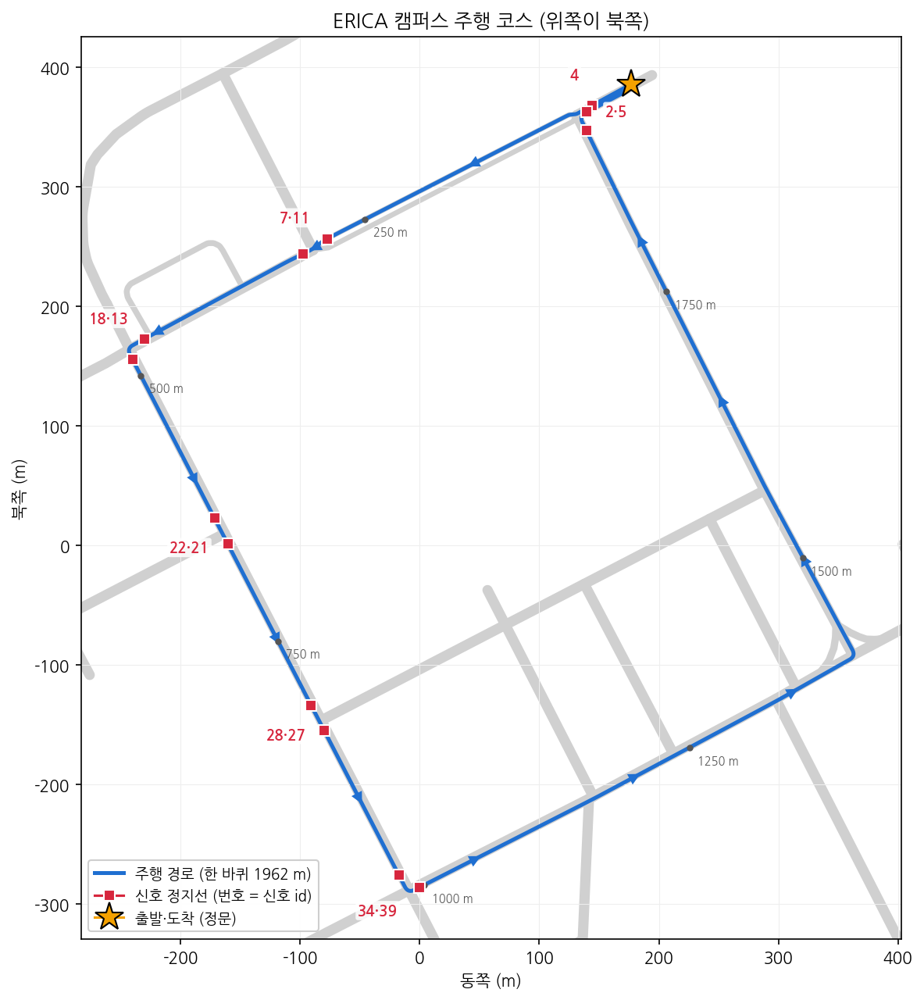
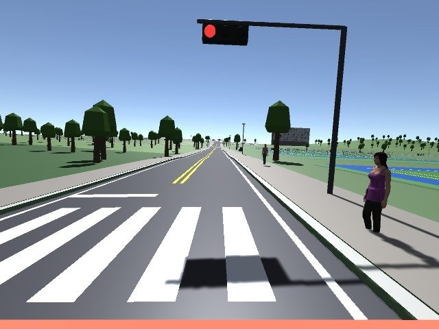
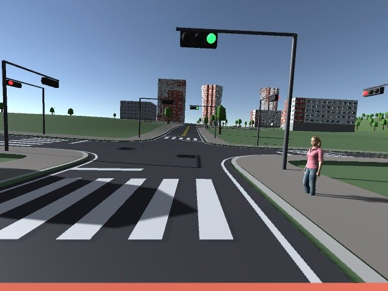
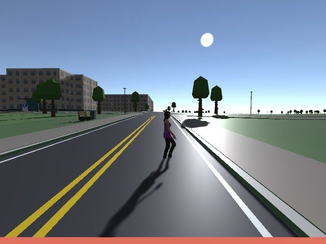
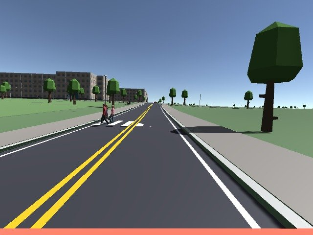
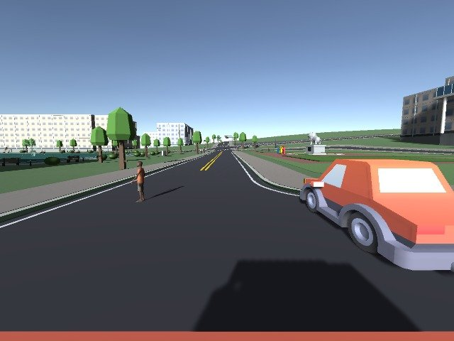
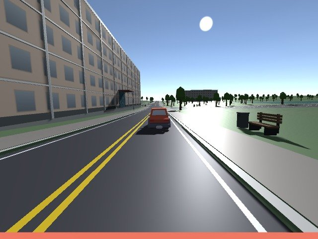
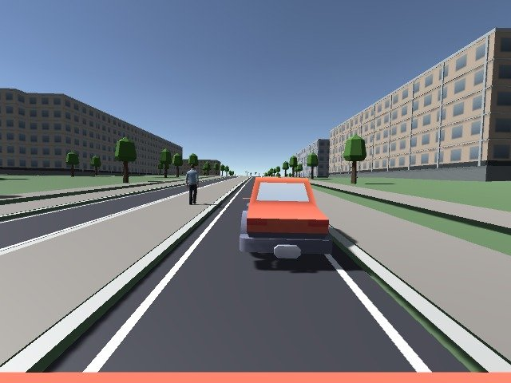
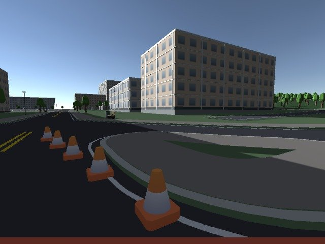
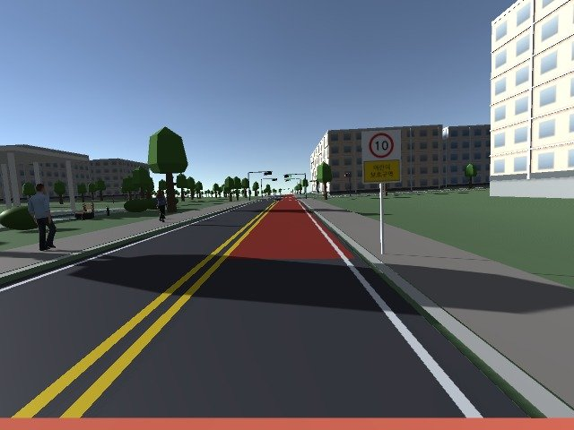

# {{과목명}} 자율주행 과제: ERICA 캠퍼스 무작위 미션 주행

카메라 영상을 OpenCV(필요하면 CNN)로 처리하고, ROS2로 차량을 움직여 시뮬레이터 속 한양대
ERICA 캠퍼스를 한 바퀴(약 1.96 km) 자율주행합니다. 주행 중에는 신호등, 무단횡단자, 끼어드는
차량, 공사 콘, 어린이보호구역 같은 **미션 8개가 매번 무작위로** 나타납니다. 위치를 외우거나
하드코딩해서는 통과할 수 없고, 보고 판단해야 합니다.

- **팀:** 2~3명
- **기간:** 4주 (배포일 기준)
- **문의:** {{문의처}}

## 1. 일정과 성적

| 시점 | 할 일 | 성적 |
|---|---|---|
| 0주차 (배포) | 환경 설치, 뼈대 코드로 한 바퀴 도는지 확인 | 없음 |
| 2주차 말 | **중간 점검:** 이벤트 없는 판에서 신호를 지키며 완주 | 10% |
| 4주차 말 | **최종 제출:** 코드, 보고서, 주행 영상 | 60% (주행) + 20% (보고서) |
| 5주차 | 발표 | 10% (발표와 영상) |

- **중간 점검(10%):** 교수자가 이벤트 없는 판(`--no-scenario`)을 한 번 돌립니다. 결과 점수(100점 만점)에 0.1을 곱합니다.
- **최종 주행(60%):** 교수자만 아는 **시드 3개**로 주행한 점수의 평균에 0.6을 곱합니다. 모든 팀이 같은 시드 3개로 채점받습니다.
- **보고서(20%)와 발표(10%):** 아래 [10. 보고서와 발표](#10-보고서와-발표)를 보세요.

## 2. 준비

### 필요한 환경

| 항목 | 요구 사항 |
|---|---|
| OS | Ubuntu 22.04 (WSL, macOS, Windows는 지원하지 않습니다) |
| ROS | ROS2 Humble (`/opt/ros/humble`) |
| GPU | NVIDIA GPU와 드라이버. 카메라 영상을 GPU로 렌더링합니다 |
| Python | 시스템 Python 3.10. **conda를 켠 터미널에서는 ROS 명령이 깨지므로 끄고 쓰세요** (`conda deactivate`) |

실습실 PC를 써도 되고, 각자 PC를 써도 됩니다. 채점 PC는 Ubuntu 22.04, NVIDIA RTX 6000 Ada(48 GB)입니다.

### 설치

```bash
git clone https://github.com/ingyu0808/avsim-assignment.git avsim-assignment
cd avsim-assignment
./scripts/get-sim.sh                          # 시뮬레이터를 받아 UnitySim/Build/Linux에 풉니다
./ros2_ws/setup_deps.sh                       # apt 의존성 설치 (sudo 필요, 처음 한 번)
source /opt/ros/humble/setup.bash
cd ros2_ws && colcon build --symlink-install && cd ..
./scripts/new-team-package.sh 07              # 팀 번호 두 자리 → ros2_ws/src/team_07
cd ros2_ws && colcon build --symlink-install --packages-select team_07 && cd ..
```

`team_07`은 뼈대 `student_driver`를 복사한 것입니다. 앞으로 이 패키지만 고치고, 이 패키지를 제출합니다.

- **시뮬레이터:** 크기 때문에 저장소에 들어 있지 않습니다. `get-sim.sh`가 저장소의 GitHub Release에서 받습니다. 받지 못하면 Releases 페이지에서 `avsim-sim-<버전>.tar.gz`를 브라우저로 받아 `./scripts/get-sim.sh <받은 파일>`로 푸세요.
- **수정본:** 공지가 오면 `git pull` 뒤 `./scripts/get-sim.sh`와 `colcon build`를 다시 실행합니다. `ros2_ws/src/team_XX`는 저장소에 없는 폴더라 pull과 겹치지 않습니다. 지금 버전은 `VERSION` 파일에 있습니다.
- **압축 묶음으로 받았다면:** `git clone` 대신 `tar xzf avsim-assignment-<버전>.tar.gz`로 풀고 그 폴더에서 시작합니다. 시뮬레이터가 이미 들어 있습니다.

## 3. 실행

터미널 두 개를 씁니다. 두 터미널 모두 먼저 `source /opt/ros/humble/setup.bash && source ros2_ws/install/setup.bash`를 실행합니다.

```bash
# 터미널 1: 시뮬레이터 (ROS 브릿지는 자동으로 뜹니다)
./scripts/run-sim.sh

# 터미널 2: 여러분의 주행 스택
ros2 launch team_07 drive.launch.py
```

뼈대 그대로 실행하면 차가 신호와 사람을 무시하고 5 m/s로 한 바퀴를 돈 뒤 정문에 멈춥니다.
처음 설치했다면 이것부터 확인하세요.

### 시뮬레이터 옵션

| 명령 | 뜻 |
|---|---|
| `./scripts/run-sim.sh` | 매번 새 무작위 판 |
| `./scripts/run-sim.sh --seed 48213` | 같은 판을 다시 (실패한 판 디버깅용) |
| `./scripts/run-sim.sh --no-scenario` | 이벤트 없는 판 (중간 점검과 같은 조건) |
| `./scripts/run-sim.sh --result /tmp/run.json` | 판이 끝나면 결과 파일을 이 경로에 씀 |
| `./scripts/run-sim.sh --headless` | 창 없이 실행 (모니터가 없을 때, GPU는 필요) |

- **시드 확인:** 판이 만들어질 때마다 시드가 플레이어 로그에 찍힙니다. 뼈대는 출발할 때 한 번 리셋하므로 **마지막 줄**이 지금 판입니다.
  ```bash
  grep "\[Scenario\] seed" ~/.config/unity3d/DefaultCompany/UnitySim/Player.log | tail -1
  ```
  결과 파일에도 시드가 들어 있습니다.
- **리셋:** `ros2 service call /reset_simulation std_srvs/srv/Trigger`로 차량을 정문으로 되돌리면 새 시드로 판이 다시 만들어집니다. `--seed`로 실행했다면 같은 판이 다시 만들어집니다.

### 문제가 생기면

| 증상 | 해결 |
|---|---|
| 창은 떴는데 `ros2 topic list`에 `/camera/image_raw`가 없다 | 브릿지가 굳은 상태입니다. `systemctl --user restart avsim-ros-bridge` 후 다시 확인 |
| `ros2 topic echo`가 `!rclpy.ok()` 오류를 낸다 | ROS 데몬 문제입니다. `ros2 daemon stop && ros2 daemon start` |
| 차가 서서 `No fresh /team/speed_limit`를 출력한다 | perception 노드가 죽었거나 1초 넘게 발행하지 않았습니다 |
| `RESET_POSE_MISMATCH`에서 멈춘다 | 다른 프로그램이 같은 ROS 도메인에 `/odom`을 내고 있습니다. `ROS_DOMAIN_ID`를 확인하세요 |
| 창이 검게 멈춘다 (모니터 없는 PC) | `--headless`로 실행하세요 |

## 4. 뼈대 코드

```
team_07/
├── team_07/route_follower.py   제공. /odom으로 경로를 따라 조향하고 속도를 정한다
├── team_07/perception.py       여러분이 채울 곳. 판단 결과로 속도 상한을 보낸다
├── team_07/control.py          route_follower의 속도 규칙 (테스트 포함)
└── launch/drive.launch.py      두 노드를 함께 띄운다 (제출할 실행 파일)
```

두 노드는 토픽 하나로만 이어집니다.

```
카메라·초음파·/odom ──▶ perception ──/team/speed_limit──▶ route_follower ──/cmd_ackermann──▶ 차량
                            ▲                                   │
                            └────────── /team/route_state ◀─────┘
```

- **`route_follower`(제공):** 정문에서 출발해 정문으로 돌아오는 경로를 `/odom`으로 따라갑니다. 곡선에서는 알아서 감속하고, 도착하면 멈춥니다.
  - 속도는 `min(순항 속도 5 m/s, 곡선 속도, /team/speed_limit)`입니다.
  - `/team/speed_limit`이 1초 넘게 안 오면 차를 세웁니다.
  - 순항 속도는 `ros2 launch team_07 drive.launch.py speed:=4.0`처럼 바꿀 수 있습니다(최대 6 m/s).
- **`perception`(빈칸):** 센서 구독, 영상 변환(`to_bgr`), 10 Hz 발행까지 되어 있습니다. `decide()`만 채우면 됩니다.
  - 지금은 항상 "제한 없음"(`NO_LIMIT`)을 돌려줍니다.
  - 노드를 더 만들거나 `route_follower`를 고치거나 통째로 바꿔도 됩니다. 단, 실행은 `drive.launch.py` 하나로 되어야 합니다.

## 5. ROS 인터페이스

### 쓸 수 있는 입력

| 토픽 | 타입 | 주기 | 설명 |
|---|---|---|---|
| `/camera/image_raw` | `sensor_msgs/Image` (rgb8, 640×480) | 20 Hz | 전방 카메라 |
| `/camera/camera_info` | `sensor_msgs/CameraInfo` | 20 Hz | fx = fy = 320, 수평 화각 90° |
| `/odom` | `nav_msgs/Odometry` | 30 Hz | **시뮬레이터 정답 위치**. x = 북, y = 서 |
| `/imu/data` | `sensor_msgs/Imu` | 100 Hz | |
| `/ultrasonic/front`, `/rear`, `/left`, `/right` | `sensor_msgs/Range` | 20 Hz | 최대 4 m |
| `/team/route_state` | `std_msgs/String` (JSON) | 20 Hz | `route_follower`가 내는 진행 상황(아래) |

카메라는 차량 기준점에서 앞으로 1.4 m, 위로 1.2 m에 있고 아래로 5° 숙여져 있습니다.

`/team/route_state`의 JSON 필드는 다음과 같습니다.

| 필드 | 뜻 |
|---|---|
| `progress_m`, `total_m` | 경로를 따라 온 거리, 전체 길이 (m) |
| `next_signal_id`, `next_signal_distance_m` | 다음 신호 정지선의 신호 id와 남은 거리. 없으면 −1 |
| `state` | 출발 준비(`WAIT_ODOM`, `WAIT_RESET_SERVICE`, `RESETTING`, `SETTLING`, 리셋 뒤 위치가 출발점과 3 m 넘게 다르면 `RESET_POSE_MISMATCH`), `DRIVING`, `COMPLETE`, `OFF_ROUTE`(경로에서 2 m 넘게 벗어나 영구 정지) |
| `lateral_error_m`, `speed`, `command_speed` | 경로 이탈 거리, 현재 속도, 명령 속도 |

신호 정지선 **위치**는 지도에 있어 알려 줍니다. 신호 **색**은 카메라로 직접 읽어야 합니다.

### 내보내는 출력

| 토픽 | 타입 | 설명 |
|---|---|---|
| `/team/speed_limit` | `std_msgs/Float32` | 뼈대 기준. m/s, 0 = 정지. 10 Hz 이상 |
| `/cmd_ackermann` | `ackermann_msgs/AckermannDrive` | 차량 제어. `speed`(m/s), `steering_angle`(rad, 양수 = 좌회전). 0.5 s 안에 새 명령이 없으면 차가 멈춥니다 |

`/cmd_ackermann`은 한 노드만 발행해야 합니다. 뼈대를 쓰면 `route_follower`가 발행합니다.

### 쓰면 안 되는 토픽

`/traffic_lights`(신호 상태 정답)와 `/traffic_lights/positions`는 여러분 PC에서는 디버깅용으로
나오지만, **채점할 때는 발행되지 않습니다.** 주행 코드가 이 토픽에 기대면 채점에서 신호를 보지 못합니다.

## 6. 주행 코스



- **경로:** 정문에서 출발해 반시계 방향으로 캠퍼스를 한 바퀴 돌아 정문으로 돌아옵니다(1962 m). 경로는 고정이고 `route_follower`가 따라갑니다.
- **신호:** 정지선이 13곳 있습니다. 그림의 번호가 `next_signal_id`입니다. 같은 교차로의 정지선은 번호를 묶어 표시했습니다.
- **완주:** 경로 끝(출발 지점 5 m 안)에 **멈추면** 완주입니다. 뼈대가 알아서 멈춥니다.
- **시간 제한:** 1200 s. 넘기면 0점입니다. 신호와 미션 대기 시간이 있으므로, 달리는 동안은 적어도 2.5 m/s를 내는 것이 안전합니다.

## 7. 미션

판마다 아래 8종 중 **8개**가 경로 위에 무작위로 놓입니다. 종류, 순서, 위치, 보행자 외형, 타이밍이 모두 달라집니다.

| 계열 | 미션 | 상황 | 해야 할 일 |
|---|---|---|---|
| 양보 | 늦게 건너는 사람 | 신호 횡단보도에서 초록불이 된 뒤 0.5~3 s 늦게 건너기 시작 | 초록불이어도 사람이 빠질 때까지 기다린다 |
| 양보 | 무단횡단 | 횡단보도가 아닌 곳에서 차가 25~40 m 앞에 왔을 때 건넘 | 멈춘다 |
| 양보 | 신호 없는 횡단보도 | 신호 없는 횡단보도를 1~3명이 건넘 | 멈춘다 |
| 양보 | 가려진 아이 | 갓길 주차 차량 뒤에서 차가 15~25 m 앞에 왔을 때 아이가 뛰어나옴 | 멈춘다. 주차 차량이 보이면 미리 감속 |
| 주의 분산 | 서 있기만 하는 사람 | 신호 횡단보도 앞 연석에 서 있고 건너지 않음 | 그대로 지나간다 (괜히 서면 감점) |
| 장애물 | 끼어드는 차 | 앞에 차가 나타나 4 m/s로 가다 3~8 s 멈췄다 다시 감 | 따라가다 멈추고, 출발하면 따라간다 |
| 장애물 | 정차 차량·공사 콘 | 차로 일부를 막은 정차 차량, 또는 콘 5개 | 20 m 안쪽에서 멈춘다. 5~15 s 뒤 치워진다 |
| 표지판 | 어린이보호구역 | 시작 표지판(빨간 원 "10", "어린이 보호구역")부터 해제 표지판까지 150~300 m, 노면이 빨갛다 | 구간 안에서 10 km/h(2.78 m/s) 이하 |

**배치 규칙**
- 계열마다 적어도 하나씩 나오고, 같은 종류는 한 판에 최대 2개입니다.
- 미션끼리는 80 m 이상 떨어져 있습니다.
- 출발 50 m와 마지막 30 m에는 미션이 없습니다.

**판 전체에 붙는 조건 (각각 50% 확률)**
- **인도 보행자 증가:** 경로 주변 인도에 사람이 24명 더 걷습니다. 인도의 사람 때문에 서면 안 됩니다.
- **낮은 해:** 해가 낮게 떠서 역광과 긴 그림자가 생깁니다.

**차량 카메라로 본 미션** (뼈대가 미션을 무시하고 지나가며 찍은 화면, 640×480)

| | |
|---|---|
|  늦게 건너는 사람: 신호 횡단보도에서 기다리다 초록불 뒤에 건넌다 |  서 있기만 하는 사람: 초록불이면 그대로 지나간다 |
|  무단횡단 (낮은 해 조건) |  신호 없는 횡단보도를 건너는 두 사람 |
|  가려진 아이: 주차 차량 옆에서 아이가 나온다 |  끼어드는 차 (낮은 해 조건) |
|  차로를 막은 정차 차량 |  차로를 비스듬히 막은 콘 5개 |
|  어린이보호구역 시작 표지판과 빨간 노면 | |

**알아 두면 좋은 것**
- **보행자:** Microsoft Rocketbox의 사실적인 사람 모델 12종입니다. 어른 9종, 아이 3종이고, 인도를 걷는 사람도 같은 모델입니다. COCO로 학습한 검출기가 "person"으로 잡습니다.
- **모델 크기:** 작은 모델(예: YOLOv8n)은 15 m 밖의 보행자를 자주 놓칩니다. 5 m/s에서 멈추려면 그보다 먼저 봐야 합니다. 거리별 검출률을 직접 재 보세요.
- **차량과 콘:** 차량(주차·끼어들기·정차)은 모두 같은 **주황빛 빨간색 로우폴리 세단**이고, 콘은 **흰 띠가 있는 주황색 원뿔**입니다. 단순화된 모델이라 CNN이 "car"로 잘 못 잡을 수 있습니다. 색, 형태, 초음파를 함께 쓰는 것을 권합니다.
- **초음파:** 4 m까지만 봅니다. 5 m/s로 달리면 초음파만으로는 늦습니다.
- **천천히 달린다고 안전하지 않습니다.** 양보 위반은 차 앞 8 m 안에 사람이 있는데 움직이면 걸립니다. 초음파(4 m)로는 이 거리를 지킬 수 없으니 카메라로 먼저 봐야 합니다.

## 8. 판정과 점수

한 판은 100점에서 시작해 위반마다 깎입니다. 0점 아래로는 내려가지 않습니다.

| 항목 | 기준 | 점수 |
|---|---|---|
| 충돌 | 미션 보행자, 차량, 콘과 접촉 | **그 판 0점** |
| 양보 위반 | 사람이 차량 앞 0~8 m, 차폭 ±1 m(중심에서 1.875 m) 안에 있는데 0.5 m/s 넘게 움직임. 사람마다 한 번 | −20 |
| 신호 위반 | 빨강이나 노랑일 때 정지선 통과. 정지선마다 | −20 |
| 보호구역 과속 | 구간 안에서 3.0 m/s 초과가 1 s 이상. 구간에 들어갈 때마다 한 번 | −10 |
| 불필요 정지 | 정당한 이유 없이 2 s 넘게 정지(0.15 m/s 미만). 정지할 때마다 한 번 | −5 |
| 근접 | 걷는 중이거나 도로 위에 있는 보행자와 1.5 m 안으로 접근. 사람마다 한 번 | −5 |
| 미완주 | 시간 초과(1200 s) 또는 도착 지점에 서지 않음 | **0점** |

**정당한 정지:** 다음 경우에 서 있는 것은 감점하지 않습니다.
- 12 m 안에 빨강·노랑 신호 정지선이 있음
- 15 m 안의 도로 위나 건너는 중인 사람이 있음
- 15 m 안의 차로에 차량·콘이 있음
- 20 m 안에서 장애물 미션이 길을 막고 있음
- 마지막 30 m(도착)

## 9. 스스로 채점하기

결과 파일에는 시드, 이번 판의 미션 목록, 위반 내역(시각·위치 포함), 보행자 최소 거리, 점수가 들어 있습니다.

```bash
./scripts/run-sim.sh --result /tmp/run.json
# 주행이 끝난 뒤 (완주 정지, 리셋, 시뮬레이터 종료, 시간 초과 때 파일이 생깁니다)
/usr/bin/python3 scripts/scenario_average.py /tmp/run.json
```

교수자가 쓰는 채점 스크립트도 그대로 들어 있습니다. 채점과 같은 조건에서 여러 시드로 돌려 평균을 낼 수 있습니다.
창 없이 돌고, 신호 정답 토픽도 끈 상태입니다.

```bash
./scripts/grade.sh --launch "ros2 launch team_07 drive.launch.py" 11 22 33
./scripts/grade.sh --launch "ros2 launch team_07 drive.launch.py" --no-scenario    # 중간 점검 조건
```

학습 데이터를 모으려면 주행 중에 `/usr/bin/python3 scripts/record_frames.py ~/frames`를 실행하세요.
카메라 영상이 0.5 s마다 JPEG로 저장되고, 파일 이름에 경로 진행 거리가 붙습니다.

## 10. 보고서와 발표

**보고서(20점, PDF)**

| 항목 | 점수 | 내용 |
|---|---|---|
| 인식 방법과 선택 근거 | 8 | 신호, 보행자, 차량·콘, 표지판을 각각 어떻게 인식하고 판단했는지. 왜 그 방법을 골랐는지 |
| 직접 측정한 성능 | 6 | 예: 거리별 보행자 검출률, 신호 색 인식 정확도, 처리 시간. 측정 방법과 표·그래프 |
| 실패 분석과 개선 | 6 | 실패한 시드와 결과 파일의 위반 내역, 원인, 고친 방법과 고친 뒤 결과 |

**발표와 주행 영상(10점):** 5주차에 발표합니다. 주행 영상은 미션이 있는 판을 처음부터 끝까지 녹화한 것 1편입니다(시드 표시).

## 11. 제출

{{제출 경로}}에 다음을 올립니다.

1. **`team_XX.zip`:** `ros2_ws/src/team_XX` 폴더 통째로
   - `ros2 launch team_XX drive.launch.py` 한 줄로 실행되어야 합니다.
   - Python 패키지가 더 필요하면 `team_XX/requirements.txt`에 버전과 함께 적습니다(예: `ultralytics==8.3.0`). 교수자는 팀마다 `python3 -m venv --system-site-packages`로 만든 가상환경에 설치하고, 노드가 그 패키지를 보도록 `PYTHONPATH`에 넣어 실행합니다. 시스템 Python 3.10 기준입니다.
   - 모델 가중치는 패키지 안에 넣습니다(전체 500 MB 이하). `setup.py`의 `data_files`에 넣고 `get_package_share_directory("team_XX")`로 경로를 찾으세요.
   - **실행 중에는 아무것도 내려받으면 안 됩니다.** 교수자는 `requirements.txt` 설치까지만 네트워크를 씁니다. 가중치가 없을 때 자동으로 받는 코드(예: `YOLO("yolov8s.pt")`에 파일 경로 대신 이름만 주는 것)는 채점에서 실패할 수 있습니다.
   - README에 의존성과 실행 방법을 적습니다.
2. **보고서 PDF**
3. **주행 영상** (또는 영상 링크)

**제출 전 확인:** 새 터미널에서 다음을 실행했을 때 문제없이 돌아야 합니다.
1. 깨끗한 워크스페이스에 압축을 풉니다.
2. `colcon build`를 실행합니다(`--symlink-install` 없이).
3. 가상환경에 `pip install -r requirements.txt`를 합니다.
4. `./scripts/grade.sh --launch "<실행 명령>" <시드>`를 돌립니다.

## 12. 규칙

- **쓸 수 있는 것:** 오픈소스 코드, 사전학습 모델(COCO 등), 시뮬레이터 영상으로 직접 만든 데이터로 학습·파인튜닝, 생성형 AI 도구. 보고서에 **출처와 사용 범위**를 밝혀야 합니다.
- **안 되는 것:**
  - 다른 팀과 코드를 공유하는 것
  - 신호 정답 토픽(`/traffic_lights`, `/traffic_lights/positions`)을 주행에 쓰는 것
  - 시뮬레이터 파일을 고치는 것
- **시드와 결과 공유:** 다른 팀과 시드나 결과를 공유하는 것은 자유입니다. 채점 시드는 비공개입니다.
- **재채점:**
  - 시뮬레이터나 브릿지 문제로 판이 깨지면 같은 시드로 다시 돌립니다.
  - 여러분 노드가 죽거나 멈춰서 생긴 결과는 그대로 채점합니다.
  - 패키지 이름이나 의존성 누락처럼 로직과 무관한 실행 오류는 한 번에 한해 고칠 기회를 줍니다. 이때 주행 점수에서 10점을 깎습니다.
